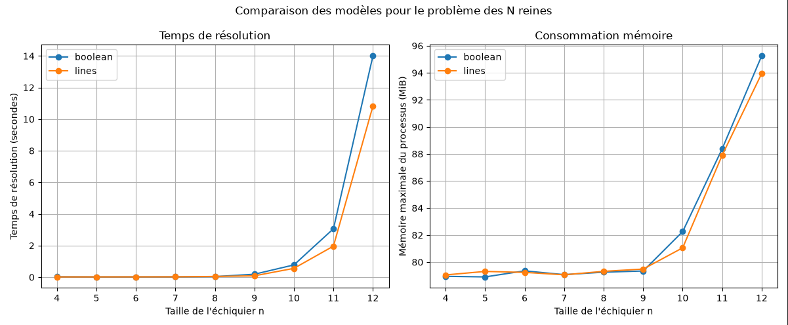

# Problème des N reines

Ce projet compare deux modèles de programmation par contraintes pour placer `n` reines sur un échiquier `n × n` sans qu’elles se menacent. Chaque ligne et chaque colonne doit contenir exactement une reine, et chaque diagonale au plus une.

## Modèles

- **Variables booléennes** (`nqueens_boolean.py`) : une variable par case de l’échiquier.
- **Variables lignes** (`nqueens_lines.py`) : une variable par ligne, dont la valeur indique la colonne de la reine.

Les scripts construisent et résolvent leur modèle indépendamment. `helpers.py` contient le code partagé pour accepter les paramètres, mesurer la résolution et produire un résultat structuré.

## Installation

Prérequis : Python 3.

```bash
python -m venv venv
venv\Scripts\Activate.ps1
python -m pip install cpmpy ortools matplotlib
```

## Exécuter un modèle

Chaque modèle accepte la taille de l’échiquier avec `--n` et affiche ses mesures au format JSON :

```bash
python nqueens_boolean.py --n 8
python nqueens_lines.py --n 8
```

## Lancer le benchmark

Le banc d’essai lance chaque script dans un processus séparé pour chaque taille demandée. Il enregistre le nombre de solutions, le temps de résolution et la mémoire maximale du processus dans un fichier CSV.

```bash
python bench_runner.py --scripts nqueens_boolean.py nqueens_lines.py --n 4 5 6 7 8 9 10 11 12 --output benchmark.csv
```

Les scripts énumèrent toutes les solutions. Les tailles élevées peuvent donc prendre beaucoup de temps, en particulier avec le modèle booléen.

## Générer le graphique

Le script de comparaison crée une image avec un graphique du temps et un graphique de la mémoire :

```bash
python compare_results.py --input benchmark.csv --output comparison.png
```

Pour également afficher le graphique à l’écran, ajoutez `--show`.

## Interpréter les résultats

Le modèle booléen représente `n²` cases, tandis que le modèle lignes représente `n` reines. Cette différence de taille de représentation peut influer sur les performances, mais ne suffit pas à prédire à elle seule le temps de résolution : celui-ci dépend aussi du solveur, de la taille `n` et de l’environnement d’exécution.

Les mesures sont prises séparément pour chaque exécution. 

Un exemple du rendu pour n = 4 5 6 7 8 9 10 11 12


